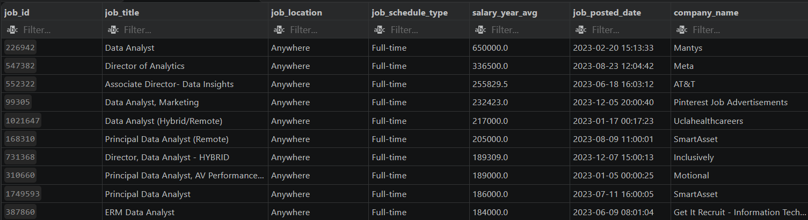
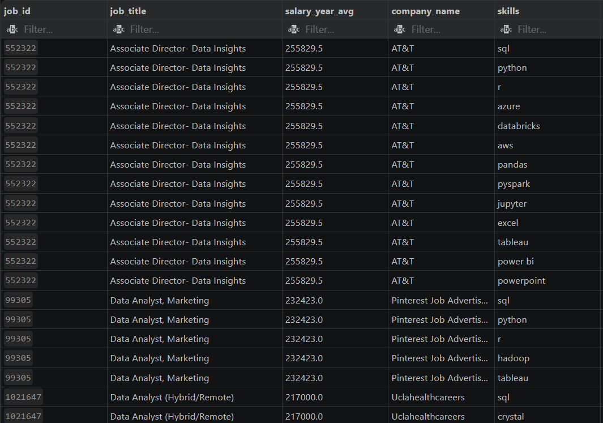
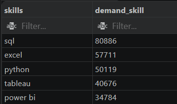
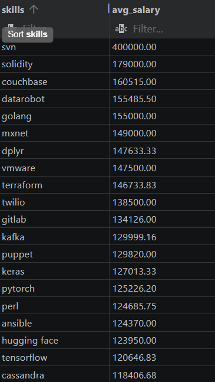
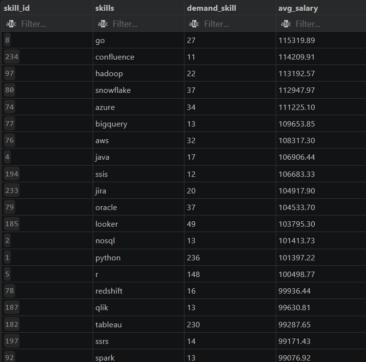

# 📊 SQL Job Market Analysis Project

## Introduction

This SQL project explores the data job market using real-world job posting data. The analysis focuses on identifying high-paying jobs, in-demand skills, salary trends, and the technologies that provide the greatest value for aspiring data professionals.

Through a collection of SQL queries, this project answers important questions about the job market and demonstrates practical SQL skills used in data analytics.

---

## Background

As an aspiring Data Analyst, I wanted to understand:

- Which jobs pay the highest salaries?
- What skills employers demand most?
- Which technologies lead to better compensation?
- What skills provide the best balance between demand and salary?

Using SQL and PostgreSQL, I analyzed job posting data containing information about companies, salaries, job locations, schedules, benefits, and required skills.

---

## Questions Analyzed

1. What are the highest-paying jobs?
2. What skills are required for top-paying jobs?
3. What skills are most in demand?
4. Which skills are associated with the highest salaries?
5. What are the most optimal skills to learn?

---

## Database Structure

### Tables Used

| Table Name | Description |
|------------|-------------|
| job_postings_fact | Job posting information |
| company_dim | Company information |
| skills_dim | Skills information |
| skills_job_dim | Mapping between jobs and skills |

---

## Tools Used

### SQL
Used for querying, joining, aggregating, and analyzing data.

### PostgreSQL
Database management system used to store and analyze job market data.

### Visual Studio Code
Environment for writing and executing SQL queries.

### Git & GitHub
Version control and project documentation.

---

# Project Structure

```text
SQL-Job-Market-Analysis
│
├── README.md
│
├── project_sql
│   ├── 1_top_paying_jobs.sql
│   ├── 2_top_paying_job_skills.sql
│   ├── 3_top_demand_skills.sql
│   ├── 4_top_paying_skills.sql
│   ├── 5_optimal_skills.sql
│
├── assets
│   ├── top_paying_jobs.png
│   ├── top_paying_job_skills.png
│   ├── demanded_skills.png
│   ├── top_paying_skills.png
│   └── optiml_skills.png
│
└── dataset
```

---

# Analysis

## 1️⃣ Top Paying Jobs

### Goal

Identify the highest-paying jobs available in the dataset.

### SQL Concepts Used

- Filtering
- ORDER BY
- LIMIT
- LEFT JOIN

### Key Findings

- Remote positions offered some of the highest salaries.
- Salaries varied significantly between companies.
- Senior and leadership roles commanded premium compensation.



---

## 2️⃣ Skills Required for Top Paying Jobs

### Goal

Determine which skills appear most frequently in high-paying positions.

### SQL Concepts Used

- Common Table Expressions (CTEs)
- INNER JOIN
- Aggregation

### Key Findings

- SQL was consistently required.
- Python appeared in most high-paying roles.
- Data visualization tools remained highly valued.



---

## 3️⃣ Most In-Demand Skills

### Goal

Find the skills most frequently requested by employers.

### SQL Concepts Used

- COUNT()
- GROUP BY
- ORDER BY

### Key Findings

- SQL dominated job requirements.
- Excel remained an important business tool.
- Python demand continued to grow.



---

## 4️⃣ Top Paying Skills

### Goal

Identify which skills command the highest average salary.

### SQL Concepts Used

- AVG()
- ROUND()
- Aggregation Functions

### Key Findings

- Cloud technologies offered higher salaries.
- Big data tools appeared among the highest-paying skills.
- Specialized technical skills generated premium salaries.



---

## 5️⃣ Most Optimal Skills

### Goal

Find skills that provide both high salary potential and strong market demand.

### SQL Concepts Used

- HAVING
- COUNT()
- AVG()
- GROUP BY

### Key Findings

- SQL provided excellent market value.
- Cloud technologies showed strong salary growth.
- Business Intelligence tools remained highly relevant.



---

# SQL Skills Demonstrated

Throughout this project, I practiced:

- Complex Joins
- Common Table Expressions (CTEs)
- Aggregate Functions
- CASE Statements
- Date Functions
- Data Cleaning
- Subqueries
- Filtering & Sorting
- Data Analysis Techniques

---

# Key Insights

### 📈 Market Demand

- SQL remains the most valuable data skill.
- Python is rapidly becoming a standard requirement.
- Visualization tools continue to grow in importance.

### 💰 Salary Trends

- Cloud-related technologies offer higher salaries.
- Specialized skills command premium compensation.
- Combining SQL with programming skills increases earning potential.

### 🎯 Recommended Skills

For aspiring Data Analysts:

- SQL
- Python
- Excel
- Power BI
- Tableau
- PostgreSQL
- Snowflake
- AWS
- Azure

---

# What I Learned

This project strengthened my:

- SQL querying skills
- Data aggregation techniques
- Analytical thinking
- Business problem-solving abilities
- Understanding of real-world job market trends

---

# Conclusion

This project demonstrates how SQL can be used to transform raw job posting data into actionable insights. By analyzing salaries, skills, hiring trends, and job requirements, I gained valuable experience in exploratory data analysis and database querying while uncovering meaningful patterns in today's data job market.

---

## Connect With Me

### LinkedIn
https://www.linkedin.com/in/ashutosh-rastogi-199b15227